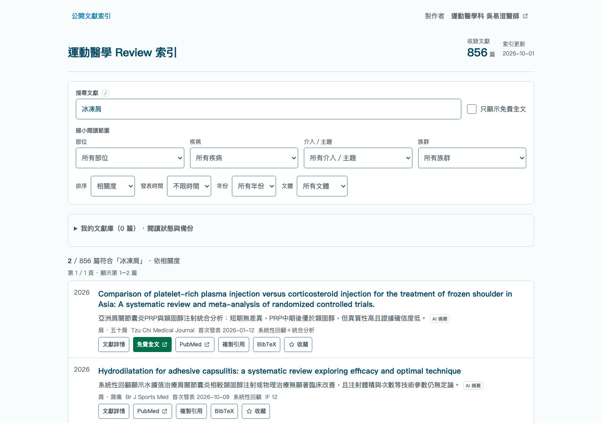

# Sports Medicine Review Index

Find sports medicine and rehabilitation reviews with English or Traditional Chinese clinical terms. Browse the evidence, inspect its sources, and keep a reading list in your browser.

[Live demo](https://review.sportsmedicine.tw/) · [繁體中文](README.zh-TW.md) · [Contribute](CONTRIBUTING.md) · [Data sources](docs/data-sources.md)



[Short workflow demo](docs/images/public-workflow.webm) · [Mobile preview](docs/images/public-mobile.png)

Screenshots show a local build of this branch; the live deployment may differ until release.

## Try it

1. Search for [frozen shoulder](https://review.sportsmedicine.tw/?q=frozen%20shoulder), [五十肩](https://review.sportsmedicine.tw/?q=%E4%BA%94%E5%8D%81%E8%82%A9), or [PRP](https://review.sportsmedicine.tw/?q=PRP).
2. Narrow the results by body region, clinical topic, population, or publication period. Open a paper to inspect its identifiers and available source metadata.
3. Save papers, mark them to read or read, then export selected references as RIS or BibTeX. Export a JSON backup to transfer your library.

The interface is in Traditional Chinese; search accepts both languages. Public browsing needs no account or API key.

## What you can do

- **Search across clinical language.** English terms, Traditional Chinese names, common abbreviations, journal names, authors, DOI, PMID, and PMCID are searchable. Related terms help recover an empty search.
- **Inspect provenance.** Paper details distinguish source metadata, source abstracts or excerpts, and AI-generated Chinese summaries. Missing fields stay visible; study type inferred from a title is labeled as an inference.
- **Understand access labels.** Source-listed free full text is distinguished from upstream access hints. Free access does not establish a reuse license.
- **Keep a local library.** Bookmarks, reading status, and saved metadata remain available when a paper leaves the rolling catalog. JSON backups preserve the library; RIS and BibTeX export references without invented authors.
- **Follow updates.** Share filtered searches, browse the latest additions, inspect data completeness, or subscribe to the [Atom feed](https://review.sportsmedicine.tw/feed.xml).

The library is stored only in this browser, with no account or device synchronization. Clearing site data can erase it. Existing title-only bookmarks can acquire snapshots when their paper is still in the catalog; an already missing paper cannot be reconstructed from its title key.

## Run locally

Use Node.js 24, as specified in [.node-version](.node-version).

```sh
git clone https://github.com/keanu77/review.sportsmedicine.git
cd review.sportsmedicine
npm ci
npm run dev
```

Open the local URL printed by Vite. The checked-in public data is sufficient to run the index; no model, cloud account, or credentials are required.

```sh
npm run typecheck
npm run test:frontend
npm run build
npm run preview
```

React, TypeScript, Vite, and Tailwind power the public interface. Browser target: Safari 16.4+, Chrome 111+, and Firefox 128+; browser automation currently covers Chromium. [Contributor setup](CONTRIBUTING.md) covers browser tests and the wider test suite.

## Scope and limits

This is a literature discovery and reading tool for education and research. It does not assess an individual patient or replace reading the original study and exercising clinical judgment. AI summaries, inferred study types, incomplete metadata, and approximate journal metrics can be wrong. Metadata verification is not clinical quality appraisal.

The repository also contains an **owner-only literature and social-drafting workbench**. The hosted workbench is not a public AI service, and the public quickstart does not configure it. Its separate setup and operations are documented in [maintainer operations](docs/maintainer-operations.md).

## Contribute

Useful contributions include bilingual search terms, source-backed metadata corrections, keyboard and screen-reader improvements, and reproducible regression tests. English and Traditional Chinese issues are welcome. See [CONTRIBUTING.md](CONTRIBUTING.md) and the [issue templates](https://github.com/keanu77/review.sportsmedicine/issues/new/choose).

If this helps your reading or teaching, a GitHub star helps others discover it.

## License and data

Project code is [MIT licensed](LICENSE). Third-party abstracts, articles, figures, and source data retain their own applicable terms; the code license does not relicense them. See [data sources and reuse boundaries](docs/data-sources.md), [security guidance](SECURITY.md), and [maintainer operations](docs/maintainer-operations.md).
